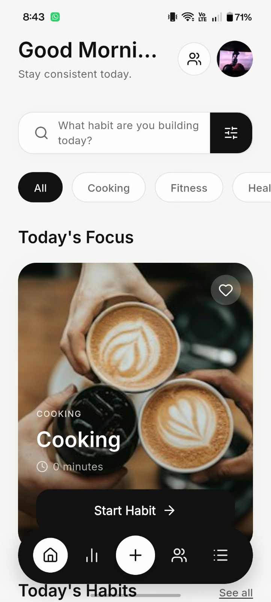
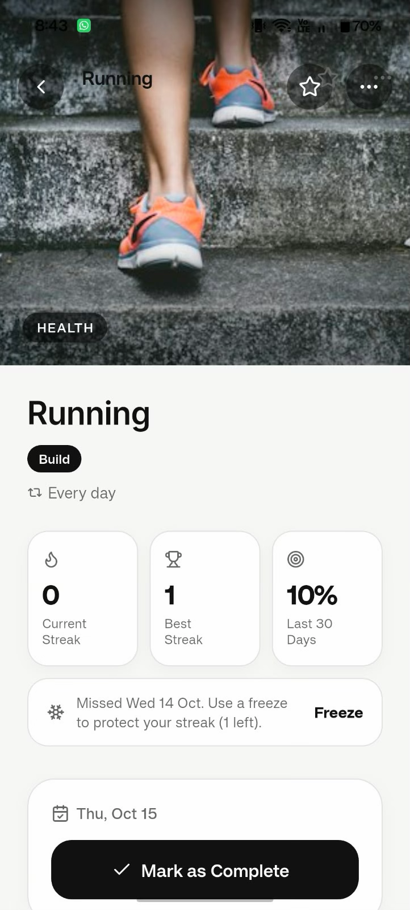
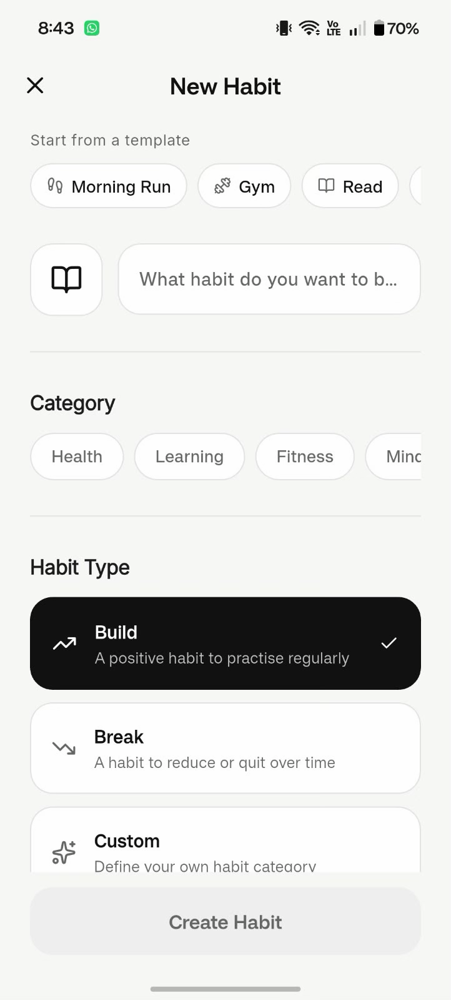
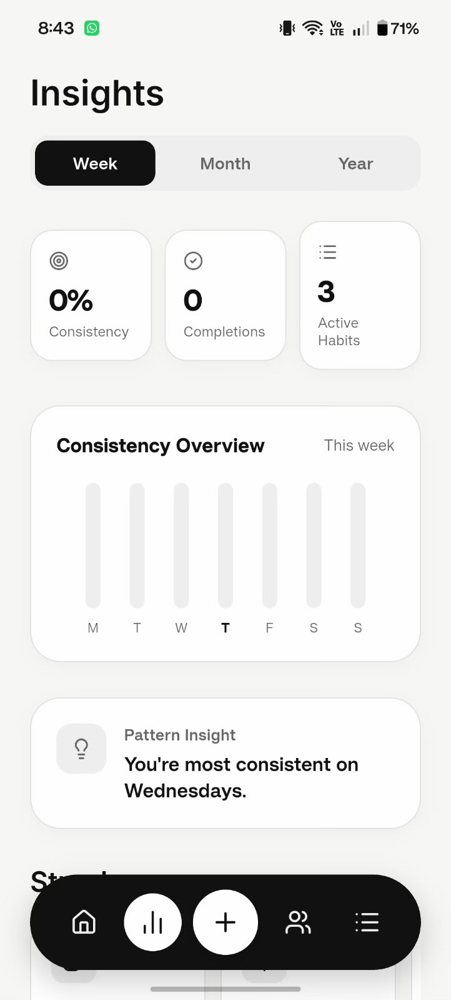
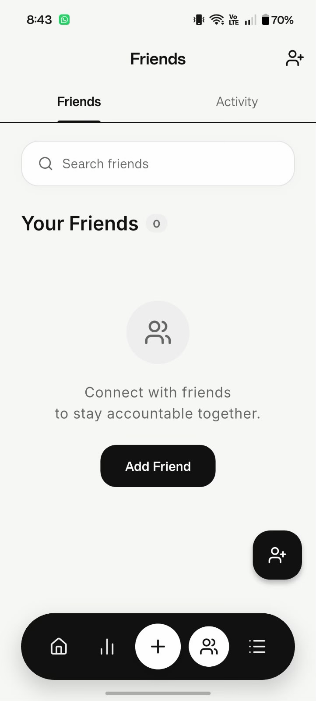
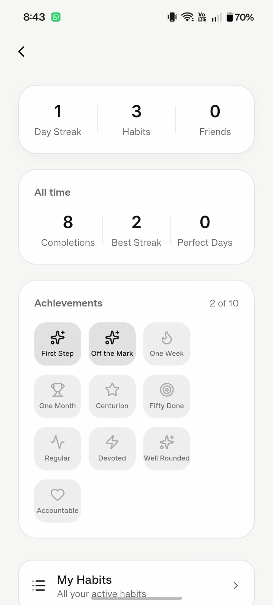
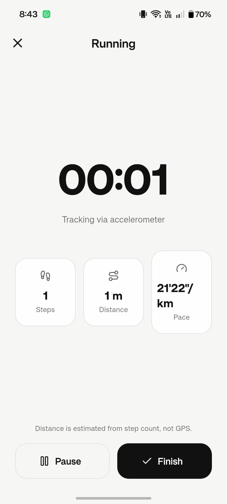
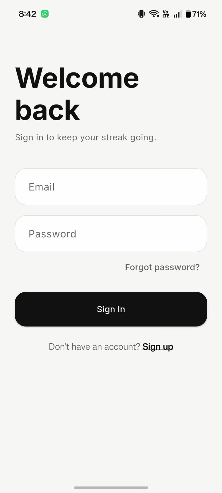
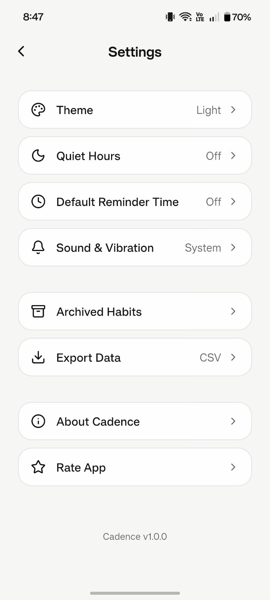
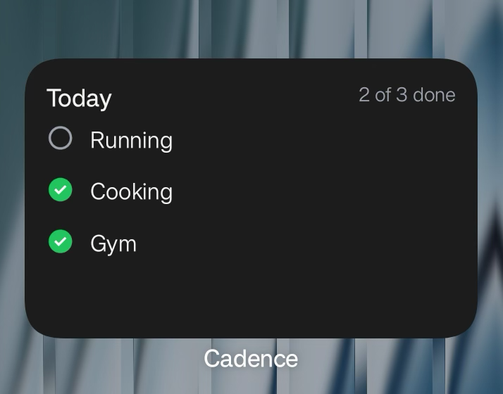

<p align="center">
  
</p>

<h1 align="center">Cadence</h1>

<p align="center">
  <b>A social habit tracker.</b> Build habits, keep streaks, and stay accountable with friends.
</p>

<p align="center">
  
  
  
  
  
</p>

---

## Screenshots

| Home | Habit detail | Add habit | Insights |
|:---:|:---:|:---:|:---:|
|  |  |  |  |

| Friends | Profile | Run tracker |
|:---:|:---:|:---:|
|  |  |  |

| Onboarding | Settings | Home-screen widget |
|:---:|:---:|:---:|
|  |  |  |

---

## Table of contents

- [Features](#features)
- [How it works](#how-it-works)
- [Tech stack](#tech-stack)
- [Project structure](#project-structure)
- [Getting started](#getting-started)
- [Push notifications (optional)](#push-notifications-optional)
- [Building a release](#building-a-release)
- [Testing](#testing)
- [Security and privacy](#security-and-privacy)
- [Troubleshooting](#troubleshooting)
- [License](#license)

---

## Features

### Habits
- **Build, break, or custom habits** with an icon, category, cover image, and an optional goal (minutes, pages, times, or your own unit).
- **Flexible schedules**: every day, specific weekdays, or *N times per week*.
- **Rest days**: planned days off that pause the schedule without breaking a streak.
- **Templates**: one tap fills the form for common habits (Morning Run, Read, Meditate, Drink Water, and more).
- **Notes and quantities**: log *how it went* ("ran 3 km in the rain", "25 pages") on any completion.
- **Reorder, favourite, archive and restore**: archived habits keep their full history.
- **CSV export** of all habits and completions.

### Streaks and motivation
- **Schedule-aware streaks**: rest days and *N-per-week* targets count correctly. The streak logic exists twice, in Dart and in PL/pgSQL, and a parity test suite keeps the two in agreement.
- **Streak freezes**: a monthly allowance that protects a missed day without extending the streak.
- **Freeze shop**: every 7-day milestone (7, 14, 21 …) earns a bonus freeze. Claiming is server-side and can't be done twice for the same milestone.
- **Achievements**: ten milestone badges (first habit, 7/30/100-day streaks, 50/250/1000 completions and more), visible to friends.
- **History heatmap** and lifetime stats on every habit.

### Verified check-ins
- **Location check-in**: a habit can require you to be within a radius of a place (the gym, the library). There's also a guard against mock-location apps.
- **Run tracker**: run/walk habits are completed by an accelerometer-based step detector, and completion is enforced by a database trigger, not just the UI.

### Reminders
- **On-device reminders** that work offline, with no server or Firebase needed.
- **Repeat until done**: per-habit follow-up reminders (every 5–240 minutes, up to 5 times) that stop as soon as you tick the habit off.
- **Quiet hours**: a do-not-disturb window that also wraps midnight (e.g. 22:00 → 07:00), respected by both reminders and friend nudges.
- **Default reminder time** pre-filled on new habits.

### Social accountability
- **Friends**: search by username, send, accept and decline requests.
- **Linked habits**: pair one of your habits with a friend's, so you're notified when they act.
- **Partner co-streaks**: a shared "N-day streak together" counter for linked habits.
- **Activity feed** with emoji **reactions**, plus **nudges** that reach a friend even when their app is closed (via FCM).
- **Block and report**: blocking hides you from search and requests; reports go to a moderation-only table.

### Everything else
- **First-run onboarding**: pick starter habits, set a reminder time, invite a friend.
- **Insights**: completion trends, best day of the week, and category breakdowns.
- **Android home-screen widget** showing today's habits.
- **Offline support**: the last-known state is cached on the device, and check-offs made offline are queued and replayed when you reconnect.
- **Light and dark themes**, profile with avatar, bio and username, and **in-app account deletion**.
- **Weekly recap push** every Sunday (optional edge function).

---

## How it works

```
┌──────────────────────────┐        ┌─────────────────────────────────────┐
│   Flutter app (Android)  │        │              Supabase               │
│                          │  REST  │  Postgres + Row-Level Security      │
│  Riverpod providers  ────┼───────►│  SQL functions (streaks, freezes,   │
│  Offline cache           │◄───────┼    block/unblock, achievements)     │
│  On-device reminders     │Realtime│  Auth (email + deep-link confirm)   │
│  Step detector, GPS      │        │  Storage (avatars, cover images)    │
│  Home-screen widget      │        │  Edge Functions (Deno)              │
└────────────▲─────────────┘        └──────────────┬──────────────────────┘
             │  FCM push (nudges, weekly recap)     │ pg_net / pg_cron
             └──────────────── Firebase ◄───────────┘
```

- **All authorization lives in the database.** Every table has RLS policies, and anything that has to be atomic or tamper-proof (spending a freeze, blocking a user, setting a username, awarding a bonus freeze) is a `security definer` function with a pinned `search_path`.
- **Friends see a curated view, not your rows.** The `friend_habits` view exposes only the columns a friend may see, so no location data and no private notes.
- **Habit reminders never touch a server.** They are scheduled on the device by `ReminderService`. Push exists only for things *another person* causes (nudges) and the weekly recap.

---

## Tech stack

| Layer | Choice |
|---|---|
| UI | Flutter 3.44, Material 3, Lucide icons, Google Fonts (Inter) |
| State | Riverpod 2 (`AsyncNotifier`, `FutureProvider.family`) |
| Backend | Supabase: Postgres, RLS, Auth, Storage, Realtime |
| Server logic | PL/pgSQL functions and triggers, Deno edge functions |
| Push | Firebase Cloud Messaging (HTTP v1, service-account OAuth) |
| Device | `flutter_local_notifications`, `sensors_plus`, `geolocator`, `home_widget` |
| Tests | `flutter_test`, unit and widget test suites in `test/` |

---

## Project structure

```
lib/
├── main.dart
├── config/            Supabase URL + publishable key
├── features/          One folder per screen
│   ├── auth/          Sign in, sign up, password reset, auth gate
│   ├── onboarding/    First-run flow
│   ├── home/          Today's habits
│   ├── add_habit/     Create / edit form, templates
│   ├── habit_detail/  Detail, heatmap, freezes, archive
│   ├── insights/      Trends and breakdowns
│   ├── friends/       Friends, requests, linking, block/report
│   ├── run_tracker/   Accelerometer-verified runs
│   └── profile/       Profile, settings, privacy, notifications
├── models/            Habit, Profile, Friend, HabitLink, RunSession
├── providers/         Riverpod notifiers (habits, friends, links, achievements …)
├── services/          Reminders, push, location, step detector, export, cache, widget
├── theme/             Light / dark palettes
└── widgets/           Shared UI components

supabase/
├── schema.sql         Initial schema: tables, RLS, functions, storage, realtime
├── migrations/        002 → 006, applied in order after schema.sql
└── functions/         send-nudge, send-weekly-recap (Deno), shared FCM helper

android/               Native widget provider, notification-settings channel
docs/                  Privacy policy, account deletion page, auth callback page
test/                  Unit and widget tests
```

---

## Getting started

### Prerequisites
- Flutter SDK with **Dart 3.12.2 or later** compatible with the constraint in `pubspec.yaml` (the original project targets Flutter 3.44)
- Java 17 and Android SDK API 36 for Android builds
- Android SDK and a device or emulator
- A free [Supabase](https://supabase.com) project

### 1. Clone and install

```bash
git clone https://github.com/GuruyuganKarthik8377/Cadence.git
cd Cadence
flutter pub get
```

### 2. Create the backend

In your Supabase project's **SQL editor**, run these files **in order**:

1. `supabase/schema.sql`
2. `supabase/migrations/002_social_and_tracking.sql`
3. `supabase/migrations/003_ownership_and_privacy.sql`
4. `supabase/migrations/004_reminders_settings_profile.sql`
5. `supabase/migrations/005_block_and_report.sql`
6. `supabase/migrations/006_freeze_shop_and_recap.sql`

Every file is idempotent, so re-running one is safe. If you re-run `schema.sql`, re-apply the migrations afterwards, because they redefine some of its policies and functions.

### 3. Point the app at your project

Edit `lib/config/supabase_config.dart` and replace the bundled project values with your own **Project URL** and **publishable (anon) key** from *Project Settings → API*. A working backend is required to use the app.

> The publishable key is designed to ship inside the app. Access control is enforced by RLS, not by keeping the key secret.

### 4. Configure auth redirects

In **Authentication → URL Configuration**:

- **Site URL**: anything that isn't `localhost`, e.g. your project URL or a hosted copy of `docs/auth-callback.html`.
- **Redirect URLs**: add `cadence://auth-callback`.

Without this, email-confirmation and password-reset links won't open the app.

### 5. Run

```bash
flutter run
```

---

## Push notifications (optional)

The app works fully without this: habit reminders are on-device. Push only adds **nudges that arrive while the app is closed** and the **Sunday weekly recap**.

1. Create a Firebase project and add an Android app with the package name `com.harishram.cadence` (or your own). Download `google-services.json` into `android/app/`. It is gitignored.
2. Generate a service-account key (*Project Settings → Service accounts*).
3. Deploy the edge functions with the [Supabase CLI](https://supabase.com/docs/guides/cli):

   ```bash
   supabase secrets set FCM_SERVICE_ACCOUNT="$(cat service-account.json)"
   supabase secrets set NUDGE_HOOK_SECRET="<any random string>"
   supabase functions deploy send-nudge
   supabase functions deploy send-weekly-recap
   ```

4. Enable the `pg_net` and `pg_cron` extensions (*Database → Extensions*). Then run the commented trigger block at the bottom of migration `002` (nudges) and the `cron.schedule` block in migration `006` (weekly recap).

---

## Building a release

For distribution, configure an upload keystore in `android/key.properties`, which is gitignored. Without this file, the current Gradle configuration falls back to debug signing; configure your upload key before publishing to the Play Store:

```properties
storePassword=<keystore password>
keyPassword=<key password>
keyAlias=upload
storeFile=/absolute/path/to/your-upload-keystore.jks
```

```bash
flutter build apk --release        # installable APK
flutter build appbundle --release  # Play Store upload (.aab)
```

Change `applicationId` in `android/app/build.gradle.kts` **before** your first Play Store upload, because it is permanent after that. To regenerate the icons and splash screen:

```bash
dart run flutter_launcher_icons
dart run flutter_native_splash:create
```

---

## Testing

```bash
flutter analyze   # static analysis
flutter test      # unit and widget tests
```

Highlights of the test suite:
- **Streak parity**: the same scenarios run against the Dart streak logic as against the SQL battery.
- **Reminders**: follow-up slot generation, quiet hours that wrap midnight, and notification-ID packing.
- **Step detection and run verification**, **offline cache round-trips**, **CSV export**, **achievements**.

---

## Security and privacy

- **RLS on every table.** Writes check ownership of the *parent* habit, so you can't insert completions, freezes or runs against someone else's habit.
- **Column-level grants** where row policies aren't enough (e.g. `friendships.blocker_id` is writable only through `block_user()`).
- **No location leaves your account.** Friends read the `friend_habits` view, which has no location columns.
- **Location is foreground-only.** No background location permission is requested.
- **Account deletion** is available in-app and via [`docs/legal/delete-account.html`](docs/legal/delete-account.html).
- **Privacy policy**: [`docs/legal/privacy.html`](docs/legal/privacy.html).

Found a security issue? Please email the address in the privacy policy rather than opening a public issue.

---

## Troubleshooting

| Symptom | Cause and fix |
|---|---|
| Everything fails with a network error; the project URL doesn't resolve | Free-tier Supabase projects **pause after a week of inactivity**. Restore the project from the dashboard; it resolves again within a minute or two. |
| Confirmation email opens `localhost` | Site URL is still the default. See [step 4](#4-configure-auth-redirects). |
| Saving a habit fails with `42703` | A migration is missing. Apply `002`–`006` in order. |
| Nudges only show while the app is open | Push isn't deployed. See [Push notifications](#push-notifications-optional). |

---

## License

Released under the [MIT License](LICENSE).

This repository imports the supplied `Cadence-main.zip` source archive. The original copyright notice for Harishram Balamurugan is preserved in `LICENSE`.
